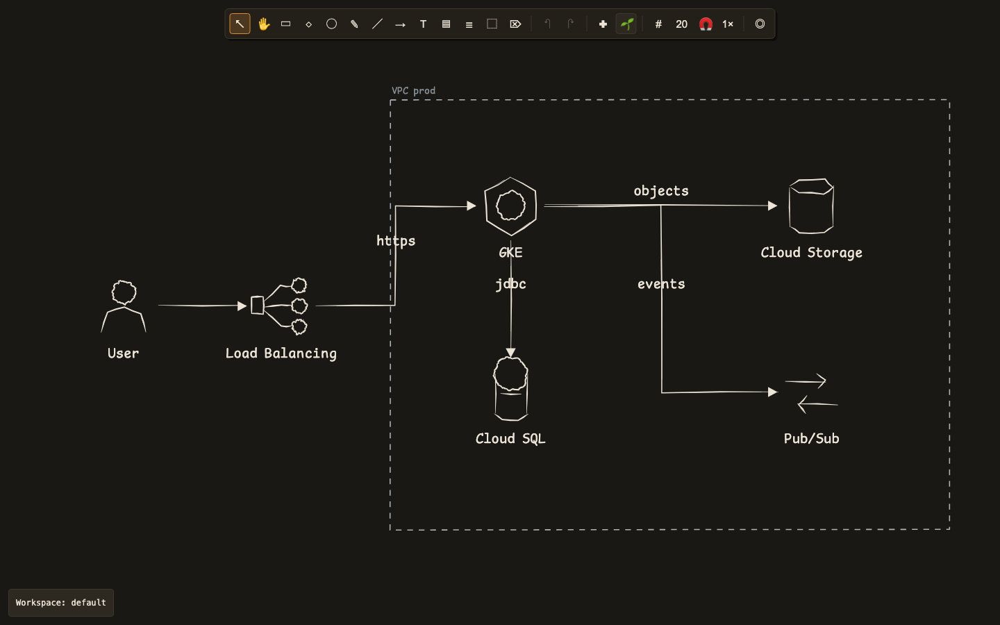

# rs-canvas

A local browser drawing tool for freehand sketching and hand-drawn cloud architecture diagrams. The document model, interaction logic and Canvas2D renderer are written in Rust and compiled to WebAssembly; the browser UI is plain JavaScript with no bundler. Everything runs on your machine — the optional agent server binds to localhost only.



## Features

- Rectangle, diamond, ellipse, line, arrow, freehand, text, sticky-note and frame tools on an infinite canvas.
- Bound, obstacle-aware connectors that re-route as elements move.
- Frames that own their contents, sticky stacks, labels, grid and snapping.
- Named workspaces with local autosave, undo/redo, and a workspace picker that works offline.
- An optional local [MCP](https://modelcontextprotocol.io) bridge that lets an AI agent read the canvas, draw and revise diagrams with the built-in GCP and generic glyph library, move the camera, take screenshots and keep discussion notes while you watch.

## Install (macOS alpha)

Prebuilt alpha builds are published as GitHub pre-releases. On a Mac:

```sh
curl -fsSL https://raw.githubusercontent.com/tmslammi/rs-canvas/master/install.sh | bash
~/.local/bin/rs-canvas
```

The installer verifies the release checksum and puts `rs-canvas` in
`~/.local/bin`; macOS 12 or newer is required. The current shell may not pick
up the new PATH until you open a new terminal, so the first launch above uses
the full path. After that, `rs-canvas` works directly.

The executable carries the front end, so the installing machine does not need
Rust, Node or a checkout. It serves the app at <http://127.0.0.1:5173> and the
MCP endpoint at <http://127.0.0.1:5173/mcp>; documents live in `~/.rs-canvas`.

To pin or roll back to a specific alpha:

```sh
curl -fsSL https://raw.githubusercontent.com/tmslammi/rs-canvas/master/install.sh \
  | bash -s -- --version 0.1.0-alpha.1
```

Apple Silicon and Intel builds are published. Linux and Windows are not yet.
Maintainer notes live in [`docs/releases.md`](docs/releases.md).

## Keyboard and gestures

| Action | Shortcut |
| --- | --- |
| Tools | `V` select, `H` hand, `R` rectangle, `D` diamond, `O` ellipse, `P` draw, `L` line, `A` arrow, `T` text, `N` sticky note, `K` sticky stack, `F` frame, `E` eraser |
| Pan | Space-drag, middle-drag, or wheel/trackpad scroll |
| Zoom | Ctrl + wheel or pinch |
| Fit / reset view | `Shift+1` / `Shift+0` |
| Undo / redo | Ctrl/Cmd+Z / Shift+Ctrl/Cmd+Z |
| Copy / cut / paste | Ctrl/Cmd+C / Ctrl/Cmd+X / Ctrl/Cmd+V |
| Duplicate / select all | Ctrl/Cmd+D / Ctrl/Cmd+A |
| Delete | Delete or Backspace |
| Nudge | Arrow keys; hold Shift for 10 px (or one grid cell with snapping) |
| Reorder | Ctrl/Cmd+] or Ctrl/Cmd+[ |
| Grid / snap | `G` / `Shift+G` |
| Cancel | Escape |

Double-click a shape to add or edit its label, a connector to label it, a frame to rename it, or a connector bend to remove the bend. Drag from a connection node to draw a bound arrow.

## Getting started

Prerequisites: Rust with the `wasm32-unknown-unknown` target, `wasm-bindgen-cli` matching the version in `Cargo.lock` (currently 0.2.129), and Node 24+.

```sh
rustup target add wasm32-unknown-unknown
cargo install wasm-bindgen-cli --version 0.2.129

cd web
npm install
npm run dev
```

Open <http://localhost:5173>. `npm run dev` builds the wasm bundle, watches Rust sources and serves the app and the agent bridge. Reload the page after a Rust rebuild.

```sh
npm run test:e2e   # build wasm and run the Playwright suite
```

## Agent bridge

The dev server exposes an MCP endpoint at `http://127.0.0.1:5173/mcp` and a WebSocket bridge to the open page. The checked-in `opencode.jsonc` and `.codex/config.toml` connect opencode and Codex to it. The agent can:

- read the drawing, the current selection and the glyph catalog (`canvas_read`, `canvas_status`, `canvas_glyphs`);
- draw and revise shapes, freehand ink, scripts and bulk grids (`canvas_draw`, `canvas_pen`, `canvas_script`, `canvas_bulk`);
- move the view and capture it (`canvas_focus`, `canvas_point`, `canvas_zoom`, `canvas_screenshot`);
- annotate, arrange and revert its own edits (`canvas_annotate`, `canvas_emphasis`, `canvas_tidy`, `canvas_clear`, `canvas_revert`);
- create a session workspace and bring the user's page to it (`canvas_workspace_create`);
- save constraints, decisions and open questions for the current workspace (`canvas_remember`).

The page remains the interactive source of truth: the agent edits a mirrored document over the same delta and merge path the browser uses, and camera commands are transient view state. The server binds to localhost only. See [`docs/adr/0005-agent-drives-canvas.md`](docs/adr/0005-agent-drives-canvas.md) for the design.

## How it works

- `crates/canvas-core` — document model, geometry, history, merge logic, shape library and Canvas2D display list. No browser dependencies.
- `crates/canvas-wasm` — the wasm-bindgen `Editor` façade and the Canvas2D renderer.
- `crates/canvas-server` — static file server, live sync bridge, MCP tools and workspace persistence.
- `web/` — ES modules, CSS and fonts. No build step beyond wasm-bindgen.

Design decisions live in [`docs/adr/`](docs/adr/); the domain vocabulary is in [`CONTEXT.md`](CONTEXT.md).

## Testing

```sh
cargo test --workspace
cargo fmt --check
cargo clippy --workspace --all-targets -- -D warnings

cd web
npm run typecheck
npm run test:e2e
```

Set `RS_CANVAS_TEST_PORT=4273` to run the Playwright suite on a different port range.

Benchmarks are local-only:

```sh
cargo run --release --example perf -p canvas-core
cd web && npx playwright test massive-bench
```

## License

MIT — see [`LICENSE`](LICENSE). GCP product names are used nominatively; the shape library contains original artwork only.
